<p align="center">
  <picture>
    <source media="(prefers-color-scheme: dark)" srcset="../../assets/brand/hero-dark.svg" />
    <source media="(prefers-color-scheme: light)" srcset="../../assets/brand/hero-light.svg" />
    
  </picture>
</p>

<h1 align="center">SwarmLoom</h1>

<p align="center"><strong>커서 무리가 하나씩 엮어 내는 과정을 지켜보세요.</strong><br/>커서 무리가 웹 페이지, 문서, 코드, 이미지와 3D 모델을 눈앞에서 한 조각씩 만들고, 그 결과를 소리가 있는 영상으로 내보냅니다.<br/>AI 에이전트 오케스트레이터가 아니라, 로컬에서 실행되는 시각적 리플레이 도구입니다.</p>

<p align="center">
  <a href="https://github.com/Boulea7/swarmloom/actions/workflows/ci.yml"></a>
  <a href="../../LICENSE"></a>
  <a href="../../CONTRIBUTING.en.md"></a>
</p>

<p align="center"><a href="../../README.md">简体中文</a> · <a href="../../README.en.md">English</a> · <a href="./README.zh-TW.md">繁體中文</a> · <a href="./README.ja.md">日本語</a> · <strong>한국어</strong> · <a href="./README.es.md">Español</a> · <a href="./README.fr.md">Français</a> · <a href="./README.de.md">Deutsch</a></p>

<p align="center">
  <a href="https://boulea7.github.io/swarmloom/studio/"><strong>온라인 Studio 체험</strong></a> ·
  <a href="https://boulea7.github.io/swarmloom/"><strong>웹사이트</strong></a> ·
  <a href="https://boulea7.github.io/swarmloom/docs/en/"><strong>문서</strong></a>
</p>

## 소개 영상

<!-- VIDEO:main -->

메인 영상을 제작 중이며, 완성되면 여기에서 바로 재생할 수 있습니다.

<!-- /VIDEO:main -->

아무것도 설치하지 않고 [온라인 Studio](https://boulea7.github.io/swarmloom/studio/)에서 같은 예시를 열어 보거나, 먼저 [그림과 함께 보는 가이드](https://boulea7.github.io/swarmloom/docs/en/getting-started.html)를 읽어 보세요.

## 지원 형식

아래 움직이는 이미지는 모두 SwarmLoom으로 실제 렌더링한 결과입니다. 선택하면 Studio에서 같은 예시를 재생합니다.

<table>
  <tr>
    <td align="center" width="33%"><a href="https://boulea7.github.io/swarmloom/studio/?example=web-demo">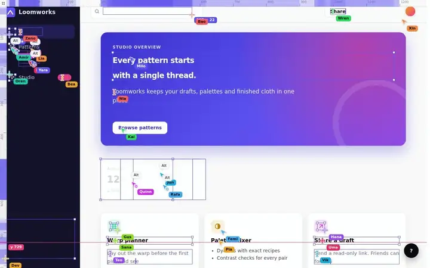</a><br/>웹 페이지</td>
    <td align="center" width="33%"><a href="https://boulea7.github.io/swarmloom/studio/?example=html-landing">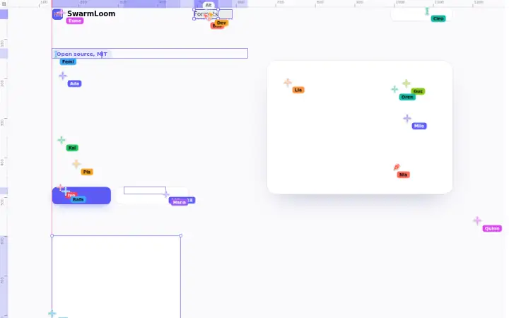</a><br/>HTML</td>
    <td align="center" width="33%"><a href="https://boulea7.github.io/swarmloom/studio/?example=svg-emblem">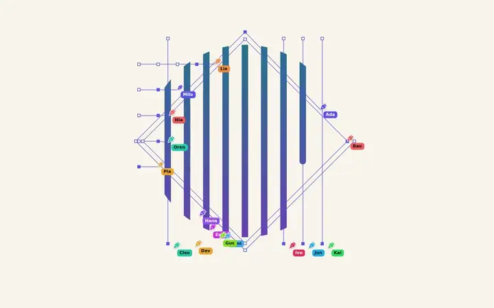</a><br/>SVG</td>
  </tr>
  <tr>
    <td align="center"><a href="https://boulea7.github.io/swarmloom/studio/?example=markdown-welcome.en">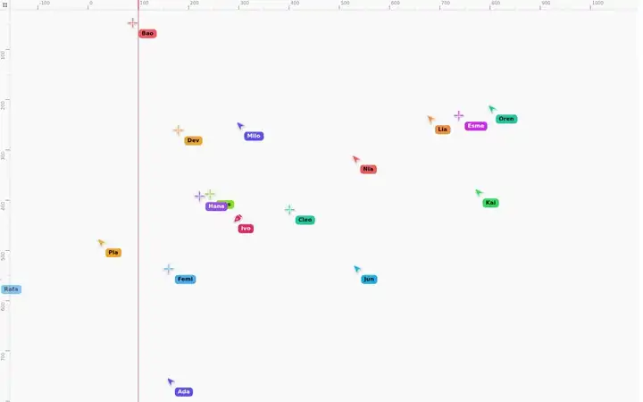</a><br/>Markdown</td>
    <td align="center"><a href="https://boulea7.github.io/swarmloom/studio/?example=docx-report">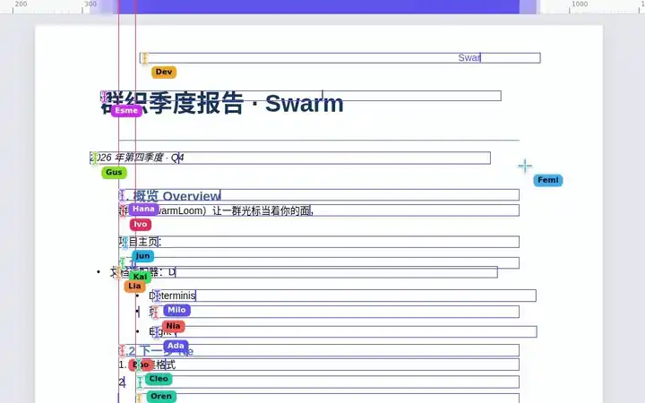</a><br/>DOCX</td>
    <td align="center"><a href="https://boulea7.github.io/swarmloom/studio/?example=doc-report">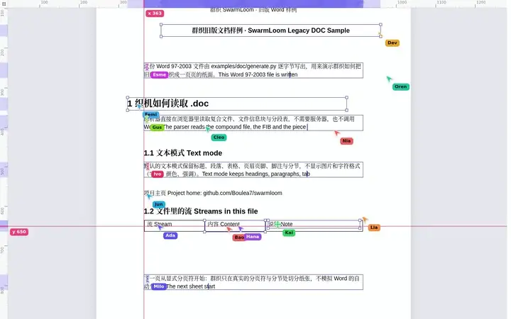</a><br/>DOC</td>
  </tr>
  <tr>
    <td align="center"><a href="https://boulea7.github.io/swarmloom/studio/?example=pdf-brochure">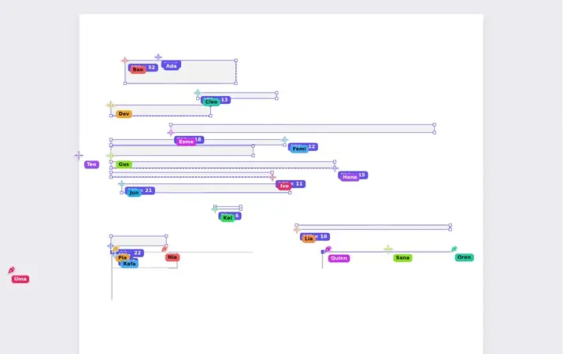</a><br/>PDF</td>
    <td align="center"><a href="https://boulea7.github.io/swarmloom/studio/?example=slides-pitch">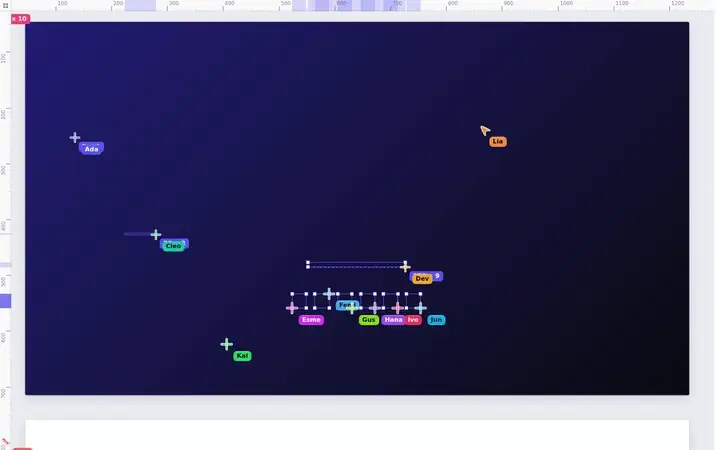</a><br/>슬라이드</td>
    <td align="center"><a href="https://boulea7.github.io/swarmloom/studio/?example=sheet-sales">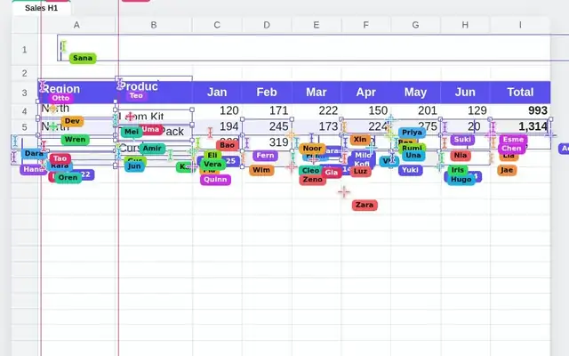</a><br/>스프레드시트</td>
  </tr>
  <tr>
    <td align="center"><a href="https://boulea7.github.io/swarmloom/studio/?example=code-swarm">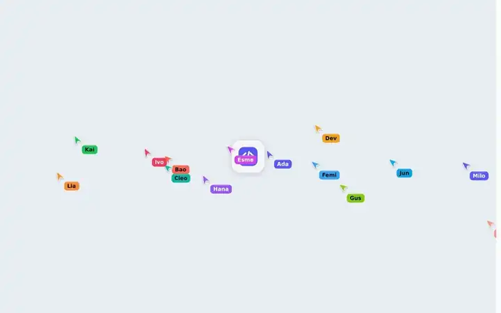</a><br/>코드</td>
    <td align="center"><a href="https://boulea7.github.io/swarmloom/studio/?example=image-scene">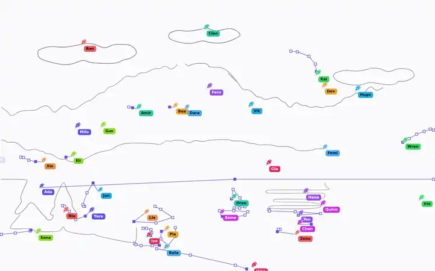</a><br/>이미지</td>
    <td align="center"><a href="https://boulea7.github.io/swarmloom/studio/?example=3d-shuttle-glb">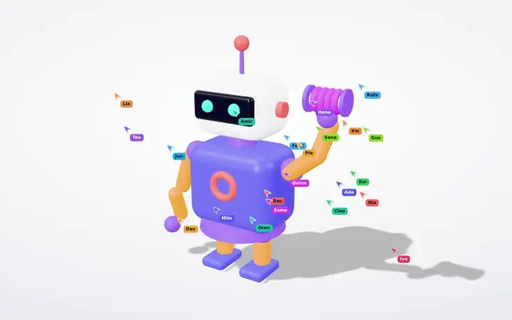</a><br/>3D 모델</td>
  </tr>
</table>

<details>
<summary>이런 형식도 열 수 있습니다</summary>

OpenDocument(ODT / ODS / ODP), EPUB, RTF, OFD, Jupyter Notebook, asciinema 터미널 녹화, Patch / Diff, XMind / FreeMind 마인드맵을 지원합니다. 스프레드시트는 XLSX / CSV / ODS, 3D는 GLB / glTF / OBJ / STL / PLY를 지원합니다. 모든 확장자와 형식별 재현 수준은 [형식 가이드](https://boulea7.github.io/swarmloom/docs/en/formats.html)에서 확인할 수 있습니다.

</details>

## SwarmLoom을 선택하는 이유

<table>
  <tr>
    <td width="50%"><picture><source media="(prefers-color-scheme: dark)" srcset="../../assets/brand/cards/web-dark.svg" /></picture><br/><b>보고 있는 페이지를 다시 만들기</b><br/>확장 프로그램이 현재 탭이나 선택한 영역을 다시 만든 뒤, 원래 페이지를 그대로 되돌려 놓습니다.</td>
    <td width="50%"><picture><source media="(prefers-color-scheme: dark)" srcset="../../assets/brand/cards/docs-dark.svg" /></picture><br/><b>다양한 형식, 하나의 무대</b><br/>문서, 스프레드시트, 슬라이드, 코드, 이미지와 3D까지 같은 커서들이 만듭니다.</td>
  </tr>
  <tr>
    <td><picture><source media="(prefers-color-scheme: dark)" srcset="../../assets/brand/cards/video-dark.svg" /></picture><br/><b>소리가 있는 영상으로 내보내기</b><br/>CLI는 MP4, WebM, GIF를 프레임 단위로 내보낼 수 있으며, 같은 설정이면 같은 화면과 소리를 얻을 수 있습니다.</td>
    <td><picture><source media="(prefers-color-scheme: dark)" srcset="../../assets/brand/cards/platforms-dark.svg" /></picture><br/><b>다양한 플랫폼</b><br/>Chrome, Edge, Firefox, Safari 확장 프로그램은 물론, PWA로 제공되는 Studio와 시계용 소형 플레이어를 지원합니다.</td>
  </tr>
  <tr>
    <td><picture><source media="(prefers-color-scheme: dark)" srcset="../../assets/brand/cards/html-svg-dark.svg" /></picture><br/><b>애니메이션도 이어서 재생</b><br/>SVG 애니메이션은 그리기가 끝나면 재생되고, CSS 애니메이션은 라이브로 전환을 선택하면 다시 시작됩니다.</td>
    <td><picture><source media="(prefers-color-scheme: dark)" srcset="../../assets/brand/cards/code-dark.svg" /></picture><br/><b>삽입하고, 스크립트로 제어</b><br/><code>&lt;swarm-loom&gt;</code> 요소, JavaScript API 또는 CLI를 사용하세요.</td>
  </tr>
</table>

## 작동 방식

<p align="center">
  <picture>
    <source media="(prefers-color-scheme: dark)" srcset="../../docs/assets/how-it-works-dark.svg" />
    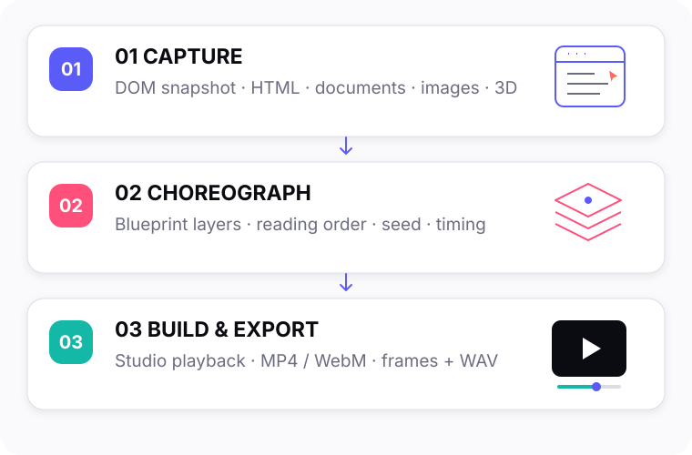
  </picture>
</p>

SwarmLoom은 웹 페이지나 파일을 레이어로 나누고, 읽는 순서에 따라 커서에 할당합니다. Studio에서는 제작 과정을 실시간으로 보여 주고, CLI는 한 프레임씩 캡처한 후 소리를 입히므로 내보내기 결과가 컴퓨터 성능에 좌우되지 않습니다.

## 빠른 시작

### 온라인에서 체험하기

[온라인 Studio](https://boulea7.github.io/swarmloom/studio/)를 열고 예시를 선택하거나 로컬 파일을 끌어다 놓거나, 텍스트를 붙여 넣거나 URL을 입력하세요. 로컬 파일은 브라우저 안에만 남습니다. URL을 입력하면 브라우저가 해당 사이트에 직접 요청하며, 사이트가 교차 출처 읽기를 허용해야 합니다.

### 소스에서 빌드하기

GitHub Releases, npm 패키지와 스토어 등록은 준비 중입니다. 지금은 소스에서 직접 빌드해야 합니다. Node.js 22.12 이상이 필요하며, pnpm 버전은 `packageManager`에 고정되어 있습니다.

```bash
git clone https://github.com/Boulea7/swarmloom.git
cd swarmloom
corepack enable
pnpm install
pnpm build
```

### CLI

저장소 루트에서 다음 명령으로 파일을 영상으로 변환할 수 있습니다.

```bash
node apps/cli/dist/cli.js render examples/svg/emblem.svg -o emblem.mp4
```

Chrome 또는 Chromium이 필요하며, MP4, WebM, GIF, WebP를 내보낼 때는 FFmpeg 4 이상도 필요합니다. `node apps/cli/dist/cli.js doctor`를 실행해 설정을 확인하세요. npm 패키지가 공개되면 `npx swarmloom`을 바로 사용할 수 있게 될 예정입니다.

### 웹 컴포넌트

`@swarmloom/element` npm 패키지는 아직 공개되지 않았습니다(공개 예정). 컴포넌트 자체는 사용할 수 있습니다.

```html
<script type="module">
  import { define } from "@swarmloom/element";
  define();
</script>

<swarm-loom
  src="./demo.md"
  type="markdown"
  agents="24"
  seed="7"
  autoplay
  controls>
</swarm-loom>
```

모든 속성과 이벤트는 [컴포넌트 가이드](https://boulea7.github.io/swarmloom/docs/en/element.html)에서 확인하세요.

## 플랫폼별 설치

스토어 등록 버전과 서명된 패키지는 아직 제공되지 않습니다. 아래 설치 방법은 모두 이전 단계에서 `pnpm build`로 만든 개발용 패키지를 사용합니다.

<details>
<summary>Chrome / Edge / Brave / Opera</summary>

- Chrome: `chrome://extensions`를 열고 개발자 모드를 켠 다음, 압축해제된 확장 프로그램을 로드를 선택하고 `apps/extension/dist/chrome/`를 지정하세요.
- Edge: `edge://extensions`를 열고 `apps/extension/dist/edge/`를 선택하세요.
- Brave / Opera: 각 브라우저의 확장 프로그램 페이지에서 개발자 모드를 켜고 같은 `dist/chrome/`를 선택하세요.
- 일반 웹 페이지에서는 도구 모음 아이콘을 클릭하거나 Alt+Shift+W를 누르세요. 브라우저 내부 페이지, 웹 스토어, 내장 PDF 뷰어에서는 확장 프로그램을 실행할 수 없습니다.

</details>

<details>
<summary>Firefox 데스크톱 및 Android(서명 버전 제공 예정)</summary>

데스크톱: `about:debugging#/runtime/this-firefox`를 열고 임시 부가 기능 로드를 선택한 다음, `apps/extension/dist/firefox/manifest.json`을 지정하세요. Firefox를 다시 시작하면 제거됩니다. Android에서도 같은 패키지를 사용하지만, 디버깅에는 web-ext, ADB와 디버깅이 켜진 기기가 필요합니다. 계속 설치해 두려면 AMO 서명 버전이 필요하며, 그전까지는 휴대폰에서 Studio를 PWA로 사용하세요.

</details>

<details>
<summary>Safari macOS / iOS / iPadOS / visionOS(실기기 테스트 및 서명 예정)</summary>

Xcode가 설치된 Mac에서 `pnpm --filter @swarmloom/extension package:safari`를 실행하고, Xcode로 `apps/extension/build/safari/`를 연 다음, 팀을 선택하고 컨테이너 앱을 실행한 후 시스템 설정에서 확장 프로그램을 켜세요. 기기에 설치하려면 Apple Developer Program에 가입해야 하며, 이들 운영체제의 실기기 테스트는 아직 완료되지 않았습니다.

</details>

<details>
<summary>PWA: 데스크톱, Android, iOS / iPadOS</summary>

Chrome / Edge에서는 Studio를 열고 주소 표시줄이나 메뉴에서 앱 설치를 사용하세요. macOS Safari에서는 Dock에 추가, Android에서는 앱 설치 또는 홈 화면에 추가, iOS / iPadOS에서는 Safari 공유 메뉴에서 홈 화면에 추가를 선택하세요. Firefox 데스크톱에서는 일반 탭에서 Studio를 사용하면 됩니다.

</details>

<details>
<summary>폴더블 기기와 스마트워치</summary>

폴더블 기기에는 추가 설치가 필요 없습니다. 브라우저가 Viewport Segments를 지원하면 Studio가 좌우 또는 상하 두 개의 창으로 나뉘고, 지원하지 않으면 일반 레이아웃을 사용합니다. 스마트워치에는 확장 프로그램이 없으며 완전한 PWA도 보장하지 않습니다. `?watch=1`을 열면 음소거 상태로 시작하는 소형 플레이어를, `?round=1`을 열면 원형 화면용 플레이어를 사용할 수 있습니다. 복잡한 장면은 다른 기기에서 내보낸 뒤 감상하세요.

</details>

## Swarm Rebuild와 비교

| 항목 | SwarmLoom에서 추가된 점 |
| --- | --- |
| 입력 | 현재 웹 페이지뿐 아니라 문서, 코드, 이미지와 3D 모델도 지원합니다. |
| 플랫폼 | Chrome 확장 프로그램뿐 아니라 Studio PWA, CLI, 웹 컴포넌트와 시계용 플레이어도 제공합니다. |
| 출력 | 소리가 있는 영상을 내보낼 수 있으며, 같은 설정이면 같은 결과를 얻을 수 있습니다. |

## 문서

[시작하기](https://boulea7.github.io/swarmloom/docs/en/getting-started.html) · [형식 및 제한 사항](https://boulea7.github.io/swarmloom/docs/en/formats.html) · [플랫폼 설치](https://boulea7.github.io/swarmloom/docs/en/install.html) · [CLI](https://boulea7.github.io/swarmloom/docs/en/cli.html) · [웹 컴포넌트](https://boulea7.github.io/swarmloom/docs/en/element.html) · [개인정보 보호](../../PRIVACY.md)

## FAQ

1. **커서 뒤에 AI가 있나요?** 아니요. 커서는 고정된 시드로 구동되는 로컬 애니메이션입니다. 모델을 호출하지 않으며, 문서나 HTML 안의 스크립트도 실행하지 않습니다.
2. **로컬 파일이 업로드되나요?** 아니요. 파일은 브라우저에서 처리됩니다. URL을 열 때만 브라우저가 해당 사이트에 접속하며, HTML이 참조하는 이미지와 글꼴은 Studio 설정에서 끌 수 있습니다. [개인정보 보호](../../PRIVACY.md)를 참고하세요.
3. **일부 페이지는 왜 그 자리에서 다시 만들 수 없나요?** 브라우저는 내부 페이지, 웹 스토어, 내장 PDF 뷰어에서 확장 프로그램 실행을 허용하지 않습니다. 대신 파일을 Studio에 끌어다 놓으세요. 로그인이 필요한 일반 웹 페이지는 확장 프로그램을 사용하세요.
4. **같은 설정이면 MP4 파일도 바이트 단위까지 동일한가요?** 프레임과 소리는 프레임 단위로 일치합니다(입력, 브라우저, 글꼴, OS, 설정이 같은 경우). 다만 인코더 버전이 다르면 MP4 파일의 바이트는 달라질 수 있습니다.
5. **휴대폰이나 스마트워치에 확장 프로그램을 설치할 수 있나요?** 휴대폰에서는 지금은 Studio를 PWA로 사용하세요. 서명된 Firefox Android 버전은 제공 예정입니다. 스마트워치는 소형 플레이어만 지원하며, 확장 프로그램과 백그라운드 재생은 제공하지 않습니다.

## 로드맵

- **현재**: 온라인 Studio, 웹 페이지와 19가지 파일 형식, 프레임 단위 CLI 내보내기, 소스에서 빌드하는 Chrome / Edge / Firefox / Safari 확장 프로그램을 지원합니다.
- **다음**: 첫 GitHub Release 및 npm 패키지 공개, 스토어 등록과 확장 프로그램 서명, Studio 내 영상 내보내기, 휴대폰 및 Safari 실기기 테스트를 준비하고 있습니다.
- **이후**: 더 많은 형식과 플랫폼을 지원할 예정이지만 날짜는 약속드릴 수 없습니다. [Ideas](https://github.com/Boulea7/swarmloom/discussions/categories/ideas)에서 아이디어를 공유해 주세요.

## 기여 및 지원

- 코드, 문서, 번역과 예시를 기여하려면 먼저 [CONTRIBUTING](../../CONTRIBUTING.en.md)과 [행동 강령](../../CODE_OF_CONDUCT.md)을 읽어 주세요.
- 사용 문의는 [Discussions Q&A](https://github.com/Boulea7/swarmloom/discussions/categories/q-a)에 남겨 주세요. 재현 가능한 버그는 [Bug Report](https://github.com/Boulea7/swarmloom/issues/new?template=bug_report.yml)로 알려 주세요.
- 추가를 원하는 형식이 있다면 [Format Request](https://github.com/Boulea7/swarmloom/issues/new?template=format_request.yml)를 이용하세요.
- 보안 문제는 공개 이슈가 아니라 [SECURITY](../../SECURITY.md)의 안내에 따라 비공개로 보고해 주세요.

## 크레딧

Joel Califa의 Swarm과 Dhvanil Patel의 Swarm Rebuild에서 영감을 받았습니다. SwarmLoom은 독립적인 클린룸 구현으로, 두 프로젝트의 코드, 상수 테이블, 시각 자산을 재사용하지 않았으며 어느 프로젝트와도 관련이 없습니다. 커서, 색상, 아이콘, 사운드와 코드는 직접 제작했거나 라이선스가 명확한 자산을 사용했습니다. 자세한 내용은 [서드파티 크레딧](https://boulea7.github.io/swarmloom/docs/en/credits.html)을 참고하세요.

홍보 영상에서 지휘자로 등장하는 Clawd는 Claude Code 마스코트를 팬이 만든 캐릭터이며, Anthropic과 관련이 없습니다.

## 라이선스

[MIT](../../LICENSE) © 2026 Boulea7 및 SwarmLoom 기여자
