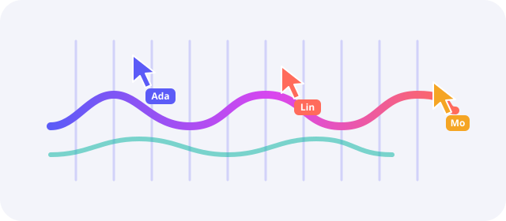

# Welcome to SwarmLoom

Watch a swarm of cursors weave it into being. SwarmLoom takes a web page, a document, some code or a
3D model and rebuilds it in front of you, one box, line and letter at a time.



> [!NOTE]
> SwarmLoom is a visual replay, not an AI agent orchestrator. The cursors follow a plan computed from
> the finished content, so the same seed always draws the same build.

## What you can weave

| Input | What the swarm does | Typical length |
| :---- | :------------------ | -------------: |
| Web page | Drags out boxes, types headings, sweeps in images | 10 s |
| Markdown | Types each block, ticks the checklist, draws formulas | 20 s |
| Source code | Lays the indent guides, then types every line | 25 s |
| PDF and slides | Frames each page, then fills it region by region | 30 s |

## How a build unfolds

1. The page dissolves and the cursors gather around the file icon.
2. They fan out and claim the boxes nearest to them, ~~one by one~~ all at once.
3. Rulers slide in, guides snap into place, and text is typed against them.
4. When the last layer lands, the swarm settles into a halo and the page goes live again.

Shortcuts while it plays:

- <kbd>Space</kbd> pauses and resumes
- <kbd>1</kbd> <kbd>2</kbd> <kbd>3</kbd> change the speed
- <kbd>M</kbd> mutes the sound
  - the first key or click anywhere unlocks audio

## Try it

Render this file to a video with the command line tool:

```bash
npx swarmloom render examples/markdown/welcome.en.md -o welcome.mp4 --seed 1 --fps 30
```

Or embed a build in your own page:

```ts
import { createPlayer } from "@swarmloom/core";
import { markdownAdapter } from "@swarmloom/adapter-markdown";

const ctx = { document, width: 920, theme: "light" as const };
const { blueprint } = await markdownAdapter.load({ name: "intro.md", text }, ctx);
await createPlayer({ blueprint, mode: "inline", host: stage, seed: 7 }).play();
```

## The maths of a deadline

A build with $n$ layers and $k$ cursors finishes in roughly $t \approx \frac{n \cdot \bar{d}}{k}$, where
$\bar{d}$ is the average time one layer takes[^pace]. The planner keeps every cursor busy:

$$
\sum_{i=1}^{k} \operatorname{busy}_i(t) \ge 0.9\,k\,t
$$

## Roadmap

- [x] Web pages, Markdown, code and SVG
- [x] Deterministic video export with sound
- [ ] Mermaid diagrams inside Markdown
- [ ] More languages for the toolbar

> Make the invisible work visible, and people will stop to watch it.

Questions or ideas? Open a discussion at https://github.com/Boulea7/swarmloom.

[^pace]: About 350 ms for a short paragraph at 1x speed; headings and images take longer.
