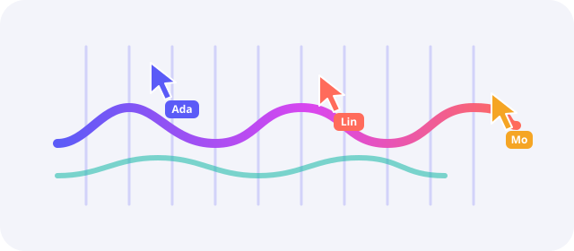

# 欢迎使用群织

让一群光标，把它织出来。群织会把网页、文档、代码或 3D 模型，当着你的面一笔一画重新搭起来：先拉出方框，再敲进文字，最后让图片从上到下显影。



> [!NOTE]
> 群织是一段可视化重放，不是 AI 智能体编排器。光标按成品算出的计划行动，同一个种子每次都织出同样的过程。

## 能织什么

| 输入 | 光标在做什么 | 大约时长 |
| :--- | :--- | ---: |
| 网页 | 拖出方框、敲出标题、扫出图片 | 10 秒 |
| Markdown | 逐块打字、勾选清单、描出公式 | 20 秒 |
| 源代码 | 先画缩进参考线，再逐行输入 | 25 秒 |
| PDF 与幻灯片 | 先搭页框，再按区域逐块填满 | 30 秒 |

## 一次重建的过程

1. 页面淡去，光标聚到文件图标周围。
2. 它们散开，各自认领离自己最近的方框，~~排队等待~~同时开工。
3. 标尺滑入，参考线吸附到位，文字沿着参考线敲出来。
4. 最后一层落定后，光标围成光环，页面恢复成可以操作的原样。

播放时的快捷键：

- <kbd>空格</kbd> 暂停或继续
- <kbd>1</kbd> <kbd>2</kbd> <kbd>3</kbd> 切换速度
- <kbd>M</kbd> 静音
  - 首次按键或点击任意位置即可解锁声音

## 动手试试

用命令行把这份文件渲染成视频：

```bash
npx swarmloom render examples/markdown/welcome.zh.md -o welcome.mp4 --seed 1 --fps 30
```

也可以嵌进自己的页面：

```ts
import { createPlayer } from "@swarmloom/core";
import { markdownAdapter } from "@swarmloom/adapter-markdown";

const ctx = { document, width: 920, theme: "light" as const, locale: "zh-CN" };
const { blueprint } = await markdownAdapter.load({ name: "介绍.md", text }, ctx);
await createPlayer({ blueprint, mode: "inline", host: stage, seed: 7 }).play();
```

## 工期估算

一次有 $n$ 个图层、$k$ 个光标的重建，耗时约为 $t \approx \frac{n \cdot \bar{d}}{k}$，其中 $\bar{d}$ 是单个图层的平均耗时[^pace]。规划器会让每个光标都有活干：

$$
\sum_{i=1}^{k} \operatorname{busy}_i(t) \ge 0.9\,k\,t
$$

## 路线图

- [x] 网页、Markdown、代码与 SVG
- [x] 带声音的确定性视频导出
- [ ] Markdown 内的 Mermaid 图表
- [ ] 工具栏支持更多语言

> 把看不见的功夫摆到台前，人们就会停下来看。

有问题或想法？欢迎到 https://github.com/Boulea7/swarmloom 发起讨论。

[^pace]: 1 倍速下，一段短文字约 350 毫秒；标题和图片会更久一些。
